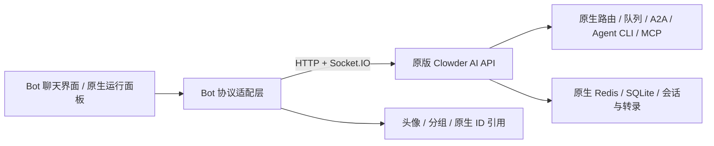

# Clowder Bot

本地运行的多成员聊天产品：界面沿用 XBot，执行引擎直接运行 [Clowder AI](https://github.com/zts212653/clowder-ai) 的原始代码。Bot 层只负责界面、产品元数据与协议适配。

后续产品方向见 [可探索特性清单](docs/feature-exploration.md)，包含复用边界、聊天体验原则与探索顺序。

首批聊天体验支持发资料与收文件、查看协作提醒，以及只读查看已保存的资料与偏好；实现范围与限制见 [1、3、5 实施记录](docs/chat-files-collaboration-memory.md#首批实施)。

## 启动

需要 **Node.js 24、npm、Git、redis-server**。pnpm 9.15.4 随项目开发依赖安装。成员接入本机已安装并配置的 Agent，沿用它的登录与默认配置。没有演示引擎，也不会在原生服务不可用时生成模拟回复。

```bash
git submodule update --init --recursive
npm ci
npm run runtime:prepare
cp .env.example .env
npm run runtime:start
```

另开终端启动 Bot：

```bash
npm run build
npm start
```

打开 **http://127.0.0.1:3210**。开发时第二个终端改用 `npm run dev`，访问 **http://127.0.0.1:5173**。运行面板位于 `/runtime.html`。

首次启动原生成员名册为空。在界面新建 Bot，选择本机检测到的执行工具，再开始聊天。角色模板直接读取上游；在「本地 Agent」中查看检测与执行状态，为 Bot 选择执行者。待审批事项在运行面板管理。原生启动包含数据库初始化和可选插件检查，看到 API listening 后再打开界面。

默认端口：Bot 3210、Clowder AI API 4331、专属 Redis 6392、原生指标 9492，均绑定本机。不要把本项目指向其他 Clowder 部署的数据或 Redis。启动器遇到端口占用会停止，不接管已有进程。

## 架构与复用



- `upstream/clowder-ai/`：Git 子模块，固定完整提交，源码保持干净。
- `.runtime/`：按 `upstream.lock.json` 生成的独立构建目录，自动应用已登记的外置补丁。
- `server/native/`：原生会话认证、消息/成员映射和实时事件转接，不实现第二套推理或调度。
- `server/xbot/`：XBot 协议适配；`client/` 保留聊天布局、猫猫头像与猫咖配色。
- `data/bot/presentation.json`：保存头像、文件夹、置顶、原生 Thread／消息引用、会话已读游标和文件元数据；文件快照保存在 Bot 文件目录，长期记忆和运行状态仍由原生管理。
- `data/native/`：原生配置、Redis AOF、SQLite、transcripts、工具与账号数据。可通过 `BOT_RUNTIME_DATA_DIR` 调整。

原自研 Orchestrator、Provider、上下文拼接、JSON 消息/记忆存储和演示路径已经移除。规划、工具执行、A2A、持久化队列、会话恢复、上下文和长期记忆由上游实现。

当前锁文件有 **6 个历史外置运行时补丁、涉及 39 个文件**，包含已合入的定时任务补丁；文件、协作状态和只读记忆这一轮未增加或修改补丁。源码子模块保持干净，详细差异与退出条件见维护台账。已有补丁不是继续修改底层的依据；成员检查属于执行准入，不是文件或长期记忆的保密隔离。

轻量后台方案保留一个 Bot 的主 Agent/session：长任务交给原生后台 subagent，进度询问和独立问题由主会话处理，调整方向通过原生消息送给对应子任务。普通新消息使用原生 `continue_current` 准入，不主动中断已有执行。本部署的 Claude 使用原生 Agent SDK carrier；其他 runtime 的同等体验尚未完成真实验收。

详见 [底层对照与 MAS 要素](docs/backend-reference.md)、[差异与升级流程](docs/upstream-maintenance.md)、[Provider 边界](docs/provider-reference.md)、[接口范围](docs/xbot-api.md)。

## 当前边界

主聊天页展示最近 200 条原生消息；运行面板支持向前分页，单聊导出读取全部分页。界面完成回执是显示格式，不伪装为模型真实工具调用。任务、队列、会话链、用量、审批和记忆检索可在运行面板查看原生数据。

原生能力与 Bot UI 覆盖率分开计算：底层有的功能，不一定已经映射为 XBot 按钮。语音、跨设备、外部渠道、复杂审批卡片、完整插件管理和 XBot 定时任务编辑器尚未适配。未知接口明确报错，不返回伪成功。当前仍是独立产品，尚未实现 Clowder AI 插件形态。

## 验证

```bash
npm test
npm run verify:frontend
npm run build
npm run verify:upstream
npm run test:background-policy
npm run test:background-output
# 以下需要已启动专属运行时
npm run test:native
npm run smoke
# 可选：会实际调用一次已登录的 Codex，消耗模型额度
BOT_MODEL_SMOKE=1 npm run test:native
# 可选：真实 Claude 后台旅程，约 5 分钟，会消耗模型额度
BOT_BACKGROUND_SMOKE=1 npm run test:background-journey
```

原生集成测试使用专用临时成员和会话，结束时通过原生接口删除测试成员、软删除测试会话，不清空存储。更多验收与上游回归命令见 [维护说明](docs/upstream-maintenance.md)。

后台旅程验收保留独立 Bot、聊天与 `.runtime/background-journey/` 证据，不删除原有数据。它核对原生子任务身份、定向消息、连续心跳和完成回报，不能代替所有复杂任务或进程故障恢复的验证。

升级前先停止两个服务并备份整个 `data/` 和 `.env`。旧版 `data/state.json` 不会被读取、覆盖或自动转换；旧会话/Provider 状态不能冒充原生会话。已有旧数据时应单独做迁移，保留原始导出。当前工作区未发现旧业务数据需要迁移。

来源、许可和精确前端差异见 [REFERENCES](docs/REFERENCES.md) 与 [前端说明](docs/xbot-frontend.md)。
