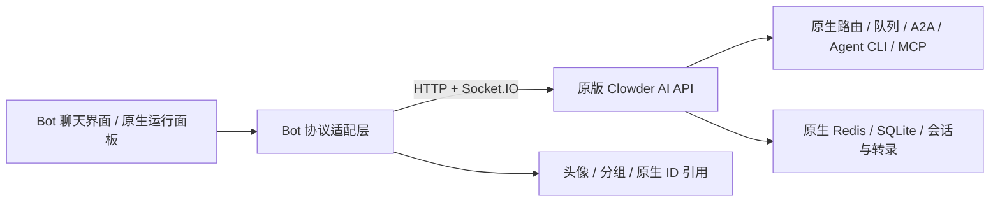

# Clowder Bot

在自己电脑上运行的聊天软件：联系人是猫猫，可以单聊，也可以拉几只进一个群。选一只猫猫、说话、发资料、收结果，不需要了解 Agent、模型、会话或工作区。界面沿用 XBot 的布局与猫咖配色，执行引擎直接运行 [Clowder AI](https://github.com/zts212653/clowder-ai) 的原始代码；Bot 层只做界面、展示数据和协议适配。

## 用起来是什么样

- **打开就能聊**。第一次打开，页面请你领一只猫猫回家：挑一只、起个名字就行。每张脸是引擎里的一只猫（猫模板）：有自己的性格和擅长，也有自己用的 Agent——布偶猫用 Claude Code，缅因猫用 Codex，梵花猫用 Kimi，其余几只用别的模型。挑的时候，选中的那只有一张卡片：它的性格、擅长和它用的 Agent。它的 Agent 这台电脑上没装、没登录或者暂不支持时，这只猫现在领不了：它排在后面，小一号，脚下一圈虚线；选中它，卡片上它的 Agent 标着原因，旁边一个「自定义」按钮，带着它的长相去自定义。「自定义」是和这些猫并列的一个选项：长相从这些猫里挑，做什么、什么性格、用这台电脑上的哪个 Agent 都自己定。选几只猫猫就是一个群聊，群名可以不填。
- **回复是活的**。发出去就看到猫猫在输入，文字逐步出现，查资料、读写文件时有一行步骤提示；随时可以停，也可以在它工作时接着说：它接得住，就在同一条回复里一起回答，排在你说的话下面，接不住就写完再另起一条。每只猫都像聊天一样说话：先说结论，通常几句话说完，要清单、表格、代码或长文时照给；这是默认的，不用设置。没写完的回复会说明是停了、没完成还是被打断，可以看原因、再发一次。
- **联系人列表**。每个对话显示最后一句话和时间，最近聊过的在上面，未读有数字，标签页标题里也有；没发出去的话留在各自的对话里。
- **找得到**。⌘K（或 Ctrl+K）搜猫猫、群聊和聊过的话，回车直接跳到那条消息；也可以只在当前对话里找。往上滚动加载更早的消息。
- **需要你点头的事在对话里问**。猫猫想记住你的一个偏好、想设一个定时提醒，会在对话里出一张卡片，原地同意或拒绝；它给的清单、选项也直接在对话里点。
- **说一句就能设提醒**。「以后每天早上 9 点提醒我喝水」→ 确认卡片 → 到点它在这个对话里叫你。设过的定时在猫猫资料的「定时」里。
- **群聊**。直接说，由一只猫猫接待；输入 @ 选某一只或全体。群可以改名、加减成员、删除。
- **资料页**。点顶栏的猫猫：资料、文件、记忆、定时四页；模型、Agent 这类技术设置收在「高级」里，平时用不到。
- **通知**。在设置里打开后，别的对话有了回复或有事等你确认，会有桌面通知。

这一阶段的方向、分轮计划、真实环境里的验证记录和已知边界见 [方向、现状与分轮计划](docs/chat-app-roadmap.md)；更长远的方向见 [可探索特性清单](docs/feature-exploration.md)。发资料与收文件、协作提醒、只读记忆的实现范围见 [1、3、5 实施记录](docs/chat-files-collaboration-memory.md#首批实施)。

## 启动

需要 **Node.js 24、npm、Git、redis-server**。pnpm 9.15.4 随项目开发依赖安装。成员接入本机已安装并配置的 Agent，沿用它的登录与默认配置。没有演示引擎，也不会在原生服务不可用时生成模拟回复。

```bash
npm ci
npm run app
```

`npm run app` 一条命令做完后面的事：第一次会取回引擎源码并准备运行环境（约 5 分钟，只需一次），构建界面，启动运行环境和应用，然后打开浏览器 **http://127.0.0.1:3210**。按 Ctrl+C 停止，它会等数据写完再退出。之后每次启动只要几秒；更新代码后再运行会自动重新构建界面。应用已经在运行时，它只打开页面，不改动任何东西。缺 Node、redis-server 或端口被占用时，它会直接说缺什么。`--no-open` 不打开浏览器，`--no-build` 不构建界面。过程记录在 `.runtime/logs/`。

它只是把下面这些步骤按需依次执行，分开运行也可以（例如开发时）：

```bash
git submodule update --init --recursive
npm run runtime:prepare      # 准备运行环境
cp .env.example .env         # 可选：改端口或数据位置
npm run runtime:start        # 终端一：运行环境
npm run build && npm start   # 终端二：应用
```

开发时终端二改用 `npm run dev`，访问 **http://127.0.0.1:5173**。运行面板位于 `/runtime.html`。

第一次打开时还没有猫猫，页面会请你领一只回家：挑一只、填个名字就能开聊，它用自己模板里的那个 Agent 思考（目前接得上的是本机已经登录的 Claude Code、Codex 和 Kimi）；一个都没有时，页面会告诉你怎么装。想细调的（模板、Agent、模型）在「更多选项」和猫猫资料的高级设置里；等你确认的事会出现在对话里，也可以在运行面板查看。

默认端口：Bot 3210、Clowder AI API 4331、专属 Redis 6392、原生指标 9492，均绑定本机。不要把本项目指向其他 Clowder 部署的数据或 Redis。启动器遇到端口占用会停止，不接管已有进程。

## 架构与复用



- `upstream/clowder-ai/`：Git 子模块，固定完整提交，源码保持干净。
- `.runtime/`：按 `upstream.lock.json` 生成的独立构建目录，自动应用已登记的外置补丁。
- `server/native/`：原生会话认证、消息/成员映射和实时事件转接，不实现第二套推理或调度。
- `server/xbot/`：XBot 协议适配；`client/` 保留聊天布局、猫猫头像与猫咖配色。
- `bot/presentation.json`（在数据目录下）：保存头像、文件夹、置顶、原生 Thread／消息引用、会话已读游标和文件元数据；文件快照保存在 Bot 文件目录，长期记忆和运行状态仍由原生管理。
- 数据目录：新安装默认在 `~/.clowder-bot/`（`native/` 是原生配置、Redis AOF、SQLite、transcripts、工具与账号数据；`bot/presentation.json` 是上面的展示数据），放在仓库之外是为了不让猫读到本仓库写给开发者的 `CLAUDE.md`／`AGENTS.md`。检出里已有 `data/` 的继续使用它。可用 `BOT_DATA_DIR` 指定，见 [维护说明](docs/upstream-maintenance.md)「数据位置」。

原自研 Orchestrator、Provider、上下文拼接、JSON 消息/记忆存储和演示路径已经移除。规划、工具执行、A2A、持久化队列、会话恢复、上下文和长期记忆由上游实现。

当前锁文件有 **6 个历史外置运行时补丁、涉及 39 个文件**，包含已合入的定时任务补丁；文件、协作状态和只读记忆这一轮未增加或修改补丁。源码子模块保持干净，详细差异与退出条件见维护台账。已有补丁不是继续修改底层的依据；成员检查属于执行准入，不是文件或长期记忆的保密隔离。

轻量后台方案保留一个 Bot 的主 Agent/session：长任务交给原生后台 subagent，进度询问和独立问题由主会话处理，调整方向通过原生消息送给对应子任务。普通新消息使用原生 `continue_current` 准入，不主动中断已有执行。本部署的 Claude 使用原生 Agent SDK carrier；其他 runtime 的同等体验尚未完成真实验收。

详见 [底层对照与 MAS 要素](docs/backend-reference.md)、[差异与升级流程](docs/upstream-maintenance.md)、[Provider 边界](docs/provider-reference.md)、[接口范围](docs/xbot-api.md)。

## 当前边界

主聊天页先展示最近 200 条原生消息，向上滚动按页加载更早的；单聊导出读取全部分页。搜索当场读取各对话最新一页，不建索引。界面完成回执是显示格式，不伪装为模型真实工具调用。任务、队列、会话链、用量和记忆检索的原生数据在运行面板查看；等你确认的事在对话里回答，对话里答不了的种类会指向运行面板。

原生能力与 Bot UI 覆盖率分开计算：底层有的功能，不一定已经映射成界面。语音、跨设备、外部渠道、音频与 HTML 小组件类的富内容、完整插件管理尚未适配；猫发来的这类内容会如实显示「还有 N 项暂时无法显示」。未知接口明确报错，不返回伪成功。当前仍是独立产品，尚未实现 Clowder AI 插件形态。

## 验证

```bash
npm test
npm run verify:frontend
npm run build
npm run verify:upstream
npm run test:background-policy
npm run test:background-output
# 以下需要已启动专属运行时
npm run test:native
npm run smoke
# 可选：会实际调用一次已登录的 Codex，消耗模型额度
BOT_MODEL_SMOKE=1 npm run test:native
# 可选：真实 Claude 后台旅程，约 5 分钟，会消耗模型额度
BOT_BACKGROUND_SMOKE=1 npm run test:background-journey
```

界面预览不需要引擎和模型：`npm run preview:fixture` 在 **http://127.0.0.1:3230** 用脚本化的协议替身运行真实的适配层，按固定上游的事件形态回放一轮回复（逐字输出、步骤、停止、失败；团子按 Claude Code 的事件形态回答，栗子按 Codex 的），也能摆出本机没有可用 Agent、需要登录等首屏状态（`POST /__preview {"agents":"ready|unknown|login|none"}`），或把每页消息数调小来看「更早的消息」怎么加载（`{"page":12}`）。回复是固定文本并写明是预览；数据在临时目录，退出即删，不会成为运行时的后备路径。

`npm run showcase` 是同一个预览，只是联系人换成摆好的一组：引擎的每个模板一只猫（名字、长相、颜色和它用哪个 Agent 思考都照模板），加两个群聊，每个对话演示一件事，在里面说话也有它自己的固定回复（`scripts/showcase-scene.ts`）。同一个地址下的 **/tour/** 是能力说明页（`showcase/`，不属于应用本身）：一页看完这个应用能做什么，开头就是这组联系人和它们现在的最后一句，每一节都能直接打开对应的对话，或让那只猫现场演示一遍。页面里的图都是界面截图：用 `TZ=Asia/Shanghai npm run showcase` 重启示例后，`BASE=http://127.0.0.1:3230/ node scripts/showcase-shots.mjs` 重拍（浏览器按示例的时区运行，图里的时间和时区在哪台电脑上重拍都一样；脚本先问 `GET /__preview`，不是摆好对话的示例就拒绝；需要本机已有的 Playwright，见 [前端接入](docs/xbot-frontend.md) 第 36、37 项）。

原生集成测试使用专用临时成员和会话，结束时通过原生接口删除测试成员、软删除测试会话，不清空存储。更多验收与上游回归命令见 [维护说明](docs/upstream-maintenance.md)。

后台旅程验收保留独立 Bot、聊天与 `.runtime/background-journey/` 证据，不删除原有数据。它核对原生子任务身份、定向消息、连续心跳和完成回报，不能代替所有复杂任务或进程故障恢复的验证。

升级前先停止两个服务并备份整个 `data/` 和 `.env`。旧版 `data/state.json` 不会被读取、覆盖或自动转换；旧会话/Provider 状态不能冒充原生会话。已有旧数据时应单独做迁移，保留原始导出。当前工作区未发现旧业务数据需要迁移。

来源、许可和精确前端差异见 [REFERENCES](docs/REFERENCES.md) 与 [前端说明](docs/xbot-frontend.md)。
