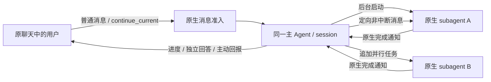

# 底层实现与 MAS 要素对照

本轮架构以 `upstream.lock.json` 固定的 Clowder AI 提交 `b2c9952f27d31480191ff6fd120789405c97238c` 为基线。结论：Bot 的生产执行链路现在直接使用原生运行时；过去“参考其思路、自己实现简化版”的代码已移除。并不意味着上游具备所有理论上的 MAS 算法，也不意味着 Bot UI 已覆盖原生平台的所有入口。

## 实际调用链

1. Bot 名称解析为原生 Cat ID，单聊/群聊解析为原生 Thread ID。
2. `/api/messages` 接收原文、原生引用 ID、幂等键和 `continue_current`；单聊显式指定成员，群聊由原生路由处理提及。原生准入负责追加活跃输入或排队，不强制中断。
3. 原生 InvocationQueue 持久化准入，AgentRouter 选择串行/并行与 A2A，invokeSingleCat 进入原生 Provider/CLI。
4. 原生上下文、MCP、会话链和消息生命周期继续运行；部署策略在原生 L0 编译结果上追加后台委派约束，保留原生身份、权限和缓存。Bot 不另造上下文编译器或传球循环。
5. Socket.IO 事件转发为浏览器 SSE；刷新和断线恢复读取原生历史。API 的 queued 回执只表示已准入，不表示任务已完成。

## 六类要素

| 要素 | 现在怎样复用 | Bot 差异与边界 |
| --- | --- | --- |
| 个体：角色、规划、记忆、工具 | 原生 Cat 配置与 roleTemplates；SystemPromptBuilder、ContextAssembler；原生 Agent services 与 MCP；原生会话/记忆服务 | 头像、文件夹属于 UI；没有 Bot 自研 Planner。规划水平取决于上游与选定模型。 |
| 环境与共享状态 | 原生 Thread、Redis stores、queue ledger、SQLite evidence/world、session/transcript；原生 projectPath 工作区 | 独立数据目录、端口、workspace。没有额外容器沙箱；执行权限沿用上游与 CLI。 |
| 通信 | 原生 messages、@ 提及、A2A lineage、串并行路由、回调身份和上下文组装 | HTTP/Socket.IO 是产品连接方式；成员执行准入增加一个外置补丁。 |
| 组织与拓扑 | 原生 AgentRouter、route-serial、route-parallel、WorklistRegistry 及相关调度 | 群聊成员映射到 preferredCats。没有另造 Supervisor/DAG。不能据此声称所有层级、辩论、网状模式都有独立完整产品。 |
| 协调与共识 | 原生 InvocationQueue、InvocationTracker、SessionMutex、queue ledger、取消、handoff 与审批 | 原生任务协议并不等于通用多数投票/合同网/MARL 奖励算法；未宣称上游未提供的算法已实现。 |
| 治理与评估 | 原生 A2A 深度限制、超时/取消、RuntimeInteraction、ApprovalHub、会话用量、OTel 指标与现有评估代码 | Bot 面板暴露部分原生交互；未支持的卡片保持待处理或明确报错。未新增独立审批引擎或假 Token 统计。 |

原生长期记忆不是旧版的 `shared/bot/conversation` 三个数组。Bot 的“会话笔记”仅映射 `/api/memory` KV；长期检索使用原生 catalog/search/recall。默认启动日志显示 embedding 关闭，不能将它描述为已启用向量检索。会话执行名单也不是长期记忆或文件访问 ACL。

## 原始源文件入口

以下均位于 `upstream/clowder-ai/`，运行时从同一提交生成并编译：

- `packages/api/src/routes/messages.ts`：消息准入与历史读取。
- `packages/api/src/domains/cats/services/agents/routing/AgentRouter.ts`、`route-serial.ts`、`route-parallel.ts`：多 Agent 编排与移交。
- `packages/api/src/domains/cats/services/agents/invocation/InvocationQueue.ts`、`InvocationTracker.ts`：持久化任务和运行生命周期。
- `packages/api/src/domains/cats/services/context/ContextAssembler.ts`、`SystemPromptBuilder.ts`：上下文与系统提示。
- `packages/api/src/domains/cats/services/session/buildThreadMemory.ts`、`stores/redis/RedisSessionChainStore.ts`：会话记忆与会话链。
- `packages/api/src/routes/memory-search.ts`、`memory-recall-page.ts`：长期记忆查询接口。
- `packages/api/src/domains/runtime-interaction/RuntimeInteractionService.ts`、`routes/approval-hub-routes.ts`：人类交互与审批。
- `packages/mcp-server/`：原生工具服务，随 API 一起构建。

## 所有权约束

| 事实 | 唯一持有者 |
| --- | --- |
| Cat 身份、persona、Provider、账号绑定 | Clowder AI 配置/注册表 |
| 消息、任务、队列、A2A、调用状态、会话、记忆、审批、用量 | Clowder AI 原生存储 |
| 头像、文件夹、置顶、UI 活动会话引用、显示序号 | Bot presentation.json |
| API 密钥、原生账号机密 | 原生账号管理或已登录 CLI；不复制进 Bot JSON |

Bot wire types 只描述 API 数据，没有第二套领域模型。presentation 存储的严格 schema 禁止写入消息、角色和凭据。显示序号只引用原生消息；XBot `send_message_to_user` 回执明确带 `presentation_receipt`，实际工具记录仍在原生 `toolEvents`。

## 本轮验收范围

适配层单测、真实原生 HTTP/Socket.IO 契约、真实 Codex 短回复与原生 session 持久化、重建/重启保留笔记、原生入口拒绝非成员，以及选定的上游 140 项队列/会话/记忆回归。未运行上游全量数千项测试；未实测所有 CLI、所有插件、多人审批竞态和全部外部连接器。

当前 pinned 版本在本机对部分可选官方插件报初始化告警（collective-connector 的包契约不匹配、personal-chrome 初始化失败）。核心 API、Redis 和 Codex 消息链路已验证正常；不把这些插件标记为可用。保持告警原样，后续可通过固定上游升级解决。

## 轻量后台 subagent 验证（2026-11-01）

一个 Bot 仍绑定一个主 Agent；后台子任务拥有原生子执行身份，不增加独立的协调 Agent、Bot 调度器或任务数据库。部署开启 `CAT_CAFE_BOT_BACKGROUND_DELEGATION=1`，Claude 使用 `CAT_CAFE_CLAUDE_CARRIER=agent_sdk`。

提示词只约束主会话：持续多步工作后台委派，短回答和有界状态读取留在主会话，不阻塞等待子任务；新消息不隐式取消；用户改变任务方向时向原子任务发消息。子任务必须自己执行，避免递归委派。缺少原生能力时明确告知，不能谎报已经后台启动或已经应用方向变更。

正式答复使用原生 `cat_cafe_post_message`，形成新的、按时间排序的原聊天消息；成功发送后不再用普通文本重复整段答复。否则同一个长驻 invocation 的多轮文本会合并进旧气泡，出现后问的问题排在答复下面。子任务带 `parent_tool_use_id` 的原始 SDK 事件保留在审计归档，不再作为主会话的文本或 idle 状态消费。

SDK 的一次 `result` 不等于整个 invocation 结束。上游已经持续消费后台通知直到原生 idle；P003 补上每轮 result 的输出检查点，刷新不足 2 秒节流窗口的尾部草稿，同时保持主会话和子任务存活。第一轮真实运行发现：进度答复已生成，但到下一次子任务事件才完整出现在历史投影，额外延迟约 28 秒。该缺陷有先失败、修复后通过的回归测试。

验收通过真实 HTTP 聊天入口执行 210 秒任务 A，询问进度，追加 75 秒任务 B，向原 A 子任务投递方向调整，再询问独立算术问题。之后不发送新输入，等待两项主动报告。除了聊天文本，还核对 raw archive 中真实后台子任务 ID、SendMessage 目标、子任务写入者、原生完成/取消统计，并检查 A 的连续心跳和进程身份。

当前验证范围是本机 Claude Code/Agent SDK、单 Bot 原聊天。其他 runtime、长达数小时的任务、进程崩溃恢复、复杂审批与高并发负载尚未完成同等验收。提示词委派仍依赖模型遵守；同一主会话仍按原生工具/模型边界接收输入，不能承诺任意时刻零延迟抢占。共享文件冲突也不会因为使用 subagent 自动消失。

最终真实验收保留为 Bot「后台旅程验收-3767663e」，证据在 `.runtime/background-journey/3767663e/evidence.json`。一个主 invocation / CLI session 启动两个后台子任务，均完成，原生统计没有失败、取消或递归委派。A 运行约 210.6 秒、209 条心跳，最大间隔 1.011 秒；B 运行约 75.6 秒、75 条心跳。两者重叠运行，A 只有一个进程身份。

| 体验 | 最终实测 |
| --- | --- |
| 原聊天问进度 | 约 10.7 秒出现新的正式回复 |
| 追加并行 B | 约 19.9 秒观察到派发确认，随后核对 B 真实起跑 |
| 调整 A | 约 13.8 秒观察到投递确认，约 34.5 秒后实际记录切换；写入来自原 A 子任务 |
| 独立问题 | 约 3.1 秒观察到回答，A/B 继续执行 |
| 完成主动回报 | 从实际完成到新消息落库：A 约 28.5 秒、B 约 21.9 秒；期间没有新用户输入 |

这些是本次模型与任务的观测值，不是时延 SLA。时间表里交互项取 HTTP 观察器时间，完成项取原生消息时间。首次验收观察器误选了旧流式气泡中的重复文字，已修正为按时间选择新回复，并独立核对六条显式 callback 消息；原失败快照也保留，没有重发任务或修改运行记录。

独立本机 Claude 审查未发现阻塞问题。当时的跟进边界是：正式回复已按时间成为新消息，但累计过程仍作为最早的一条聊天回复重复展示；后续呈现修复见下节。P003 由先失败后通过的专项回归证明，callback 旅程本身不能单独证明草稿刷新效果；该补丁目前覆盖单聊串行路由，群聊并行路由未补齐同样的检查点。

## 后台对话的呈现边界（2026-11-02）

用户在「后台旅程验收-3767663e」发现，第一条猫回复包含后来才发起的 B 任务与最终报告。原生历史中，一个长期存活的 invocation 只有一条持续增长的 stream 记录，时间戳为首次创建时间；每次 `cat_cafe_post_message` 则有独立 callback 记录和实际发送时间。旧适配层给两种记录都生成了聊天发送回执，因此累计内容出现在最早气泡中。这是消息类别映射错误，不能用按正文拆分或修改时间戳来纠正。

`server/native/message-presentation.ts` 按同一成员与精确 turn 身份关联 stream/callback，在已有显式发言时将累计记录标记为 `activity`，前端以可展开的执行过程呈现。正式回复仍按原生顺序展示。单聊和群聊均携带每条消息的真实 `speaker`，避免当前选中的猫覆盖其他发送者身份。分类只作用于读取投影，不删除或改写原生记录；没有关联证据、错误和取消的回复保留普通消息呈现。当前关联限定在返回页内，跨分页时保守保留普通回复。

本次验证：常规测试 43 通过、2 个按需原生集成项跳过；构建、生产 smoke、前端完整性和上游完整性通过。浏览器检查了原验收对话的首条正式回复、默认折叠与展开内容；隔离夹具检查了单聊/群聊不同猫与已移除成员的身份，以及 SSE 更新后保留展开状态、阅读过程中不跳到底部。原验收对话 14 条原生消息的修复前后 SHA-256 完全一致，投影为 5 条用户输入、1 条执行过程、8 条正式回复，顺序保持。证据保存在 `.runtime/chat-presentation-fix/live-evidence.json`，截图为同目录的 `chat-fixed.jpg` 和 `multi-cat-verified.jpg`。本次没有重新触发真实长程模型任务，验证范围是呈现修复。
